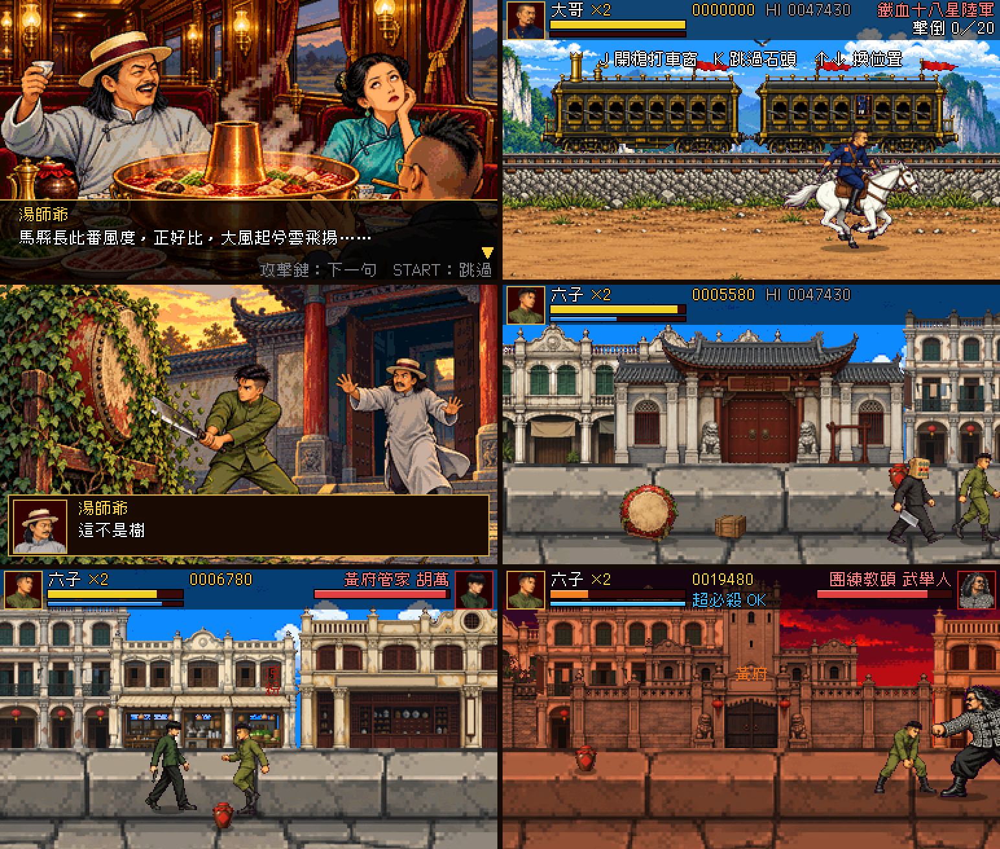

# 讓子彈飛：鵝城快打（試玩版）

以電影《讓子彈飛》為故事主軸的街機風橫向清版動作遊戲（像《吞食天地》《恐龍快打》）。**同人非官方作品。**

線上玩：https://pokemonida99.github.io/bullets-fly/



## 試玩版內容

- 標題 → 選角 → 開場劇情插圖（青石嶺、火車火鍋「大風起兮雲飛揚」、讓子彈飛一會兒）→ **序章 青石嶺 劫火車**（騎白馬打車窗裡的陸軍、甩板斧翻車）→ 劇情插圖（鬧鐘逼問、上任鵝城、城門）→ **第一關 鵝城** → 結局插圖與正式版預告
- 第一關：城門 → 縣衙前（冤鼓滾過來）→ 涼粉攤（中頭目胡萬）→ 黃昏街道 → 黃府碉樓門前（頭目武舉人）
- 鴻門宴過場 → **第二關 夜襲縣衙**（假麻匪、屋頂掃射、頭目胡萬）→ 綁票過場 → **小遊戲 散銀子**（丟越多分數越高）→ 花姐、四筒對四筒、「翻譯翻譯，什麼叫驚喜」
- 選六子當玩家，六子活著；選其他角色，照劇本六子在涼粉案死去
- 過場、關卡中的對話都是劇本原句配 GPT 畫的劇情插圖（15 張）
- 可選：張牧之（張麻子）、老二、老三、六子、老湯（高難度）；老四、老五、老七正式版登場（名字照劇本的稱呼）
- 劇情整理在 `docs/story.md`（依使用者提供的電影劇本，標出場次），角色設計與劇照對照在 `docs/characters.md`
- 致敬電影的元素：九筒麻將面具、馬拉火車、會滾的冤鼓、武舉人的兩隻燒鵝、涼粉、麻袋銀子、鵝城匾額、黃府碉樓

## 操作

| 動作 | 鍵盤 | 手把 | 手機 |
|---|---|---|---|
| 移動 | 方向鍵／WASD | 十字鍵 | 左搖桿 |
| 攻擊 | J／Z | A | 攻 |
| 跳 | K／X | B | 跳 |
| 招式一 | L／C | X | 招一 |
| 招式二（打中扣自己一點血） | I／V | Y | 招二 |
| 超必殺（怒氣滿） | 空白鍵／O | RB | 超 |
| 暫停 | Esc／P | Select | START |
| 靜音 | M | | |

連按兩下方向＝跑，跑步中攻擊＝衝刺攻擊；走到敵人身上會抓住（攻擊＝膝撞，反方向＋攻擊＝往後摔）。

## 版本

`js/data.js` 的 `VERSION` 與 `CHANGELOG`（改版時一起改）；標題畫面左下角有版本號，按 ↑ 看更新紀錄，桌墊右上角也有按鈕。
改了 js 之後跑 `tools/bump.sh`，把 `index.html` 所有 `?v=` 一起加一。

## 美術流程（GPT 生圖）

- 角色造型照電影劇照（見 `docs/characters.md`），用 ChatGPT.app 內建 codex 生圖：先畫設定圖（`work/art/ref_*.png`），再以設定圖為參考畫 4×2 洋紅底動作表
- `python3 work/make_jobs.py 1|2`（v0.1 設定圖）、`python3 work/make_jobs3.py a|b`（v0.2 動作表、劇情插圖、序章）產生工作清單 → `work/run_jobs.sh` 平行生圖（已有的會跳過；要重畫就刪掉 `work/art/<名稱>.png`）
- 每位主角 7 張動作表（A1 站走、A2 跳／受傷、B1 B2 連打、C1 招式、C2 超必殺與勝利、R 騎馬），共 56 格
- 街景是分層的：`sky_day`／`sky_dusk` 天空、`f_*` 建築立面（去背）、`ground` 石板路，程式依位置排列並隨進度染上夕陽色
- `python3 tools/slice.py [預覽.png]`：切動作表 → `js/sprite_data.js`
- `python3 tools/stage_art.py [預覽.png]`：背景、標題圖、結局圖、頭像 → `js/art_data.js`
- `python3 tools/props.py [預覽.png]`：道具表 `work/art/props.png`（冤鼓、酒罈、木箱、燒鵝、涼粉、銀元、金條、麻袋銀子）→ `js/prop_data.js`
- `work/` 只在本機（GPT 原圖、提示詞）

## 檔案

```
index.html        入口、觸控按鍵、桌墊出招表
js/core.js        畫布、像素字、輸入（鍵盤／觸控／手把）、防誤觸放大與選取
js/audio.js       音效（即時合成）、配樂播放（music/*.mp3 循環，切掉結尾淡出）
music/            配樂：theme＝《讓子彈飛》、stage＝《策馬向前》、boss＝《金戈鐵馬》（使用者提供）
js/sprites.js     動作格載入與繪製、程式畫的小道具
js/data.js        版本、角色招式、敵人、關卡、台詞
js/game.js        玩家、敵人 AI、頭目、打擊判定、關卡流程
js/scenes.js      繪製（分層街景）、HUD、各場景、劇情過場、主迴圈
js/ride.js        序章「青石嶺 劫火車」騎馬關
js/bonus.js       小遊戲「散銀子」
tools/bot.js      開發用自動測試（瀏覽器注入：runBot(角色) 第一關、runRide(角色) 序章）
```

## 授權

- 配樂三首由使用者提供（music/）；程式、音效原創；美術由 GPT 依電影劇照造型繪製成像素風（不使用電影原始畫面）
- 字型：俐方體 11 號（Cubic 11），OFL 授權，見 `fonts/OFL.txt`
- 電影台詞只引用短句，出處見 `docs/story.md`
